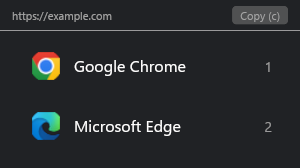
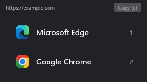

# choose-browser

Choose which browser opens each link.

Set Choose Browser as your default browser once. When you open a link from
another app, a small window lets you pick one of your installed browsers.

Supports Linux and Windows 10/11 (x64).
macOS integration is not implemented yet.

## Why use it?

- Open work links in Edge and personal links in Chrome, choosing each time.
- Check a page in different browsers while developing or testing a website.
- Keep several browsers in use without changing your default browser for every link.
- Put your favorite browsers first and hide the ones you do not use.

## How it works on Windows



1. [Install Choose Browser](#install-on-windows).
2. In **Settings > Apps > Default apps**, select **Choose Browser** for **HTTP**
   and **HTTPS**. The installer opens this settings page for you.
3. Open a web link from another app, such as an email client or chat app.
4. Click the browser you want, or press its number. That browser opens the link
   and the chooser closes.

The link appears at the top of the window. Press `c` or click **Copy** to copy
it instead, or press `Esc` to close the chooser.

| Shortcut | Action |
| --- | --- |
| `1`–`9` | Open the link in the corresponding browser |
| `c` | Copy the link and close the chooser |
| `Esc` | Close the chooser |

To try the chooser directly after installing, run in PowerShell:

```powershell
& "$env:LOCALAPPDATA\Programs\ChooseBrowser\choose-browser.exe" https://example.com
```

These screenshots show the app running on Windows with Chrome and Edge
installed. Your list depends on the browsers installed on your computer.
If only one browser remains after applying your configuration, links open
directly in that browser.

## Install on Linux

```sh
curl -fsSL https://raw.githubusercontent.com/tarcisiomiranda/choose-browser/main/install.sh | sh
```

Installs to `~/.local/bin` (or `/usr/local/bin` as root) and sets itself as the
default browser.

```sh
CHOOSE_BROWSER_VERSION=v0.1.0 sh          # pin a release
CHOOSE_BROWSER_SKIP_REGISTER=1 sh         # binary only
CHOOSE_BROWSER_INSTALL_DIR="$HOME/bin" sh # custom path
```

## Install on Windows

Run in PowerShell:

```powershell
curl.exe -fsSL https://raw.githubusercontent.com/tarcisiomiranda/choose-browser/main/install.ps1 | Out-String | Invoke-Expression
```

Or use PowerShell's built-in downloader:

```powershell
irm https://raw.githubusercontent.com/tarcisiomiranda/choose-browser/main/install.ps1 | iex
```

Downloads the Windows executable, verifies its SHA-256 checksum, and installs to
`%LOCALAPPDATA%\Programs\ChooseBrowser` without administrator privileges. The
installer opens **Settings > Apps > Default apps**: select **Choose Browser**
for **HTTP** and **HTTPS** to use the chooser when opening links.

The release must include `choose-browser-windows-amd64.exe`. To build from a
checkout instead, follow the Windows build instructions below.

The same `CHOOSE_BROWSER_VERSION`, `CHOOSE_BROWSER_SKIP_REGISTER`, and
`CHOOSE_BROWSER_INSTALL_DIR` environment variables are supported. When running
a downloaded script, you can also pass `-Version`, `-InstallDir`, or `-SkipRegister`.

```powershell
& "$env:LOCALAPPDATA\Programs\ChooseBrowser\choose-browser.exe" --list-all
```

## Usage

```sh
choose-browser https://example.com
choose-browser --list
choose-browser --list-all
choose-browser --config-path
choose-browser --init-config
choose-browser --uninstall
```

`1`–`9` open a browser, `c` copies the URL, `Esc` closes.
Copy uses the native clipboard on Windows. On Linux, it needs `wl-copy` or `xclip`.

On Windows, browsers are discovered from their registered installations,
including per-user and 32-bit installations. Portable browsers without Windows
registration are not detected. The chooser excludes itself from the list.

## Config

`choose-browser --init-config` writes `~/.config/choose-browser/config.toml`.
On Windows, it writes `%APPDATA%\choose-browser\config.toml`.

```toml
[browsers]
show_only = []
hidden = []
order = []
```

IDs come from `--list-all`.

For example, to put Edge before Chrome on Windows, change `order` in the
existing `[browsers]` section:

```toml
order = ["Microsoft Edge", "Google Chrome"]
```



Use `hidden` to remove browsers from the chooser, or `show_only` to include
only specific browsers. Rules accept the IDs from `--list-all` or the visible
browser names. Changes apply the next time the chooser opens.

## Build

```sh
mise install
mise run install
```

On Windows, install [Visual Studio Build Tools](https://visualstudio.microsoft.com/downloads/)
with **Desktop development with C++** and a Windows SDK, plus
[mise](https://mise.jdx.dev/installing-mise.html). Then run in PowerShell:

```powershell
mise trust
mise install rust python
mise run install
```

`mise run build` creates `target\release\choose-browser.exe`.
`mise run dev -- https://example.com` opens the chooser from source.
`mise run ci` runs the platform's checks, including offline installer tests.

## Uninstall

```sh
./uninstall.sh
```

On Windows, run `mise run uninstall` from the checkout or:

```powershell
.\uninstall.ps1
```

To remove only the browser registration, run the installed executable with
`--uninstall`. Configuration files are preserved. Select your preferred
browser in Windows Settings after uninstalling.

## License

MIT
